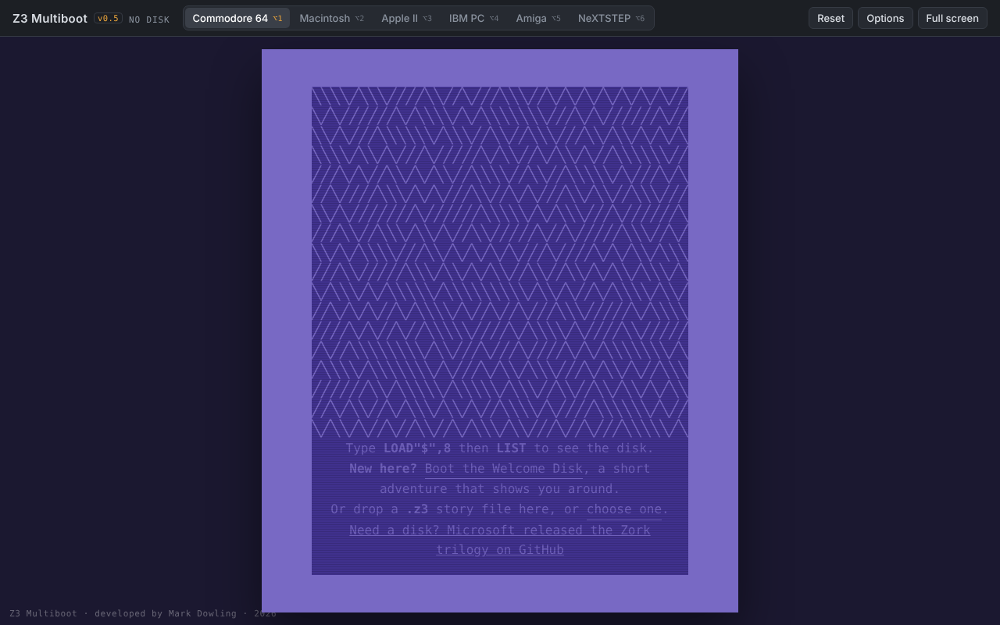
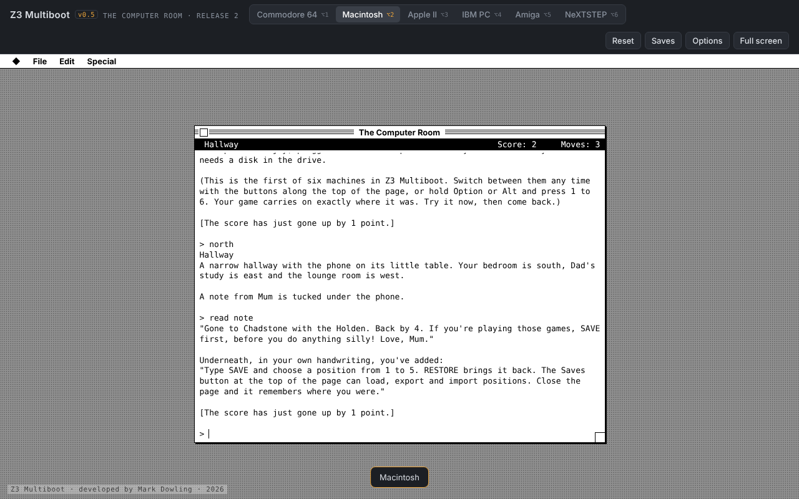
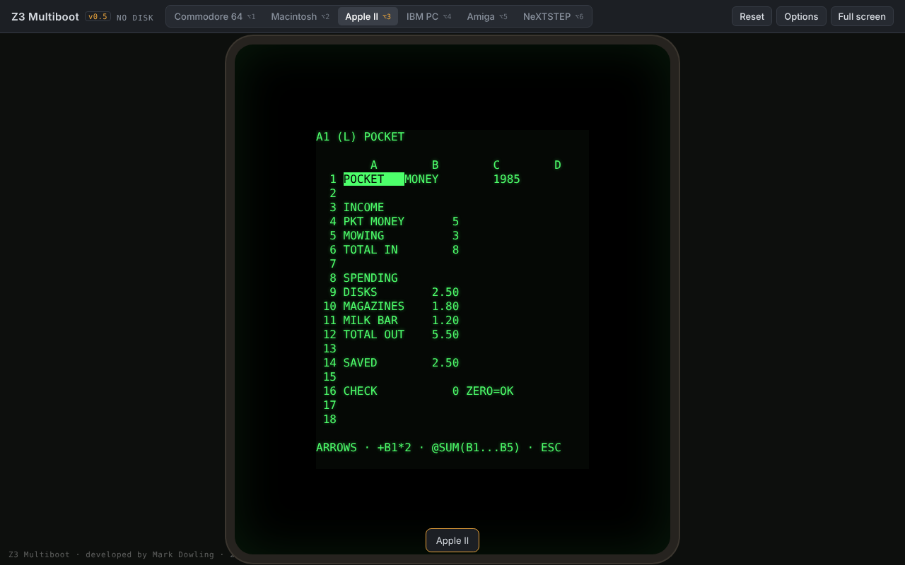
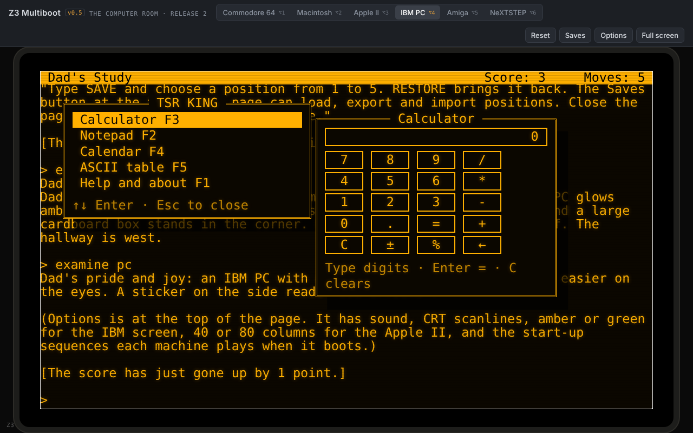
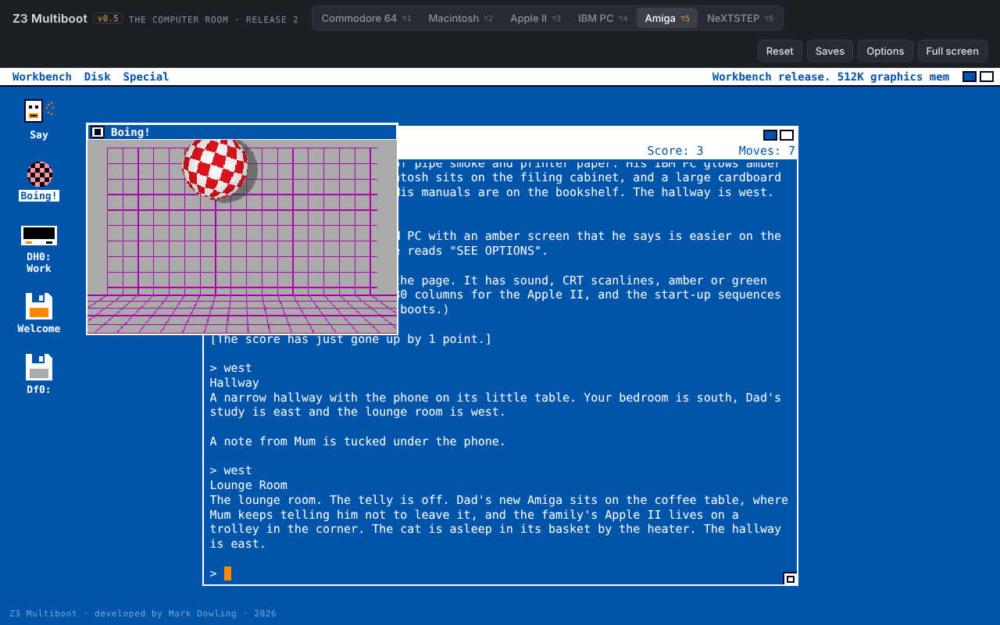
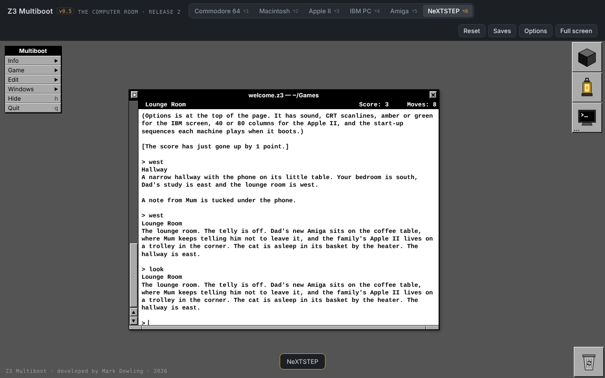

# Z3 Multiboot

**Classic text adventures on six 1980s computers · Version 1.0 · November 2026**

Drop a story file on the page and a Commodore 64, Macintosh, Apple II, IBM PC, Amiga or NeXTSTEP boots it. Zork and the other classic Infocom adventures: any game made in the version 3 Z-machine format. Each machine comes with software of its own to play with, and the built-in Welcome Disk shows you around. It's one self-contained HTML file of about 155 KB (it still fits on a C64 floppy), with no install and no internet needed once it's loaded.

**▶ Play it here:** https://markdowlingsretros.github.io/z3-multiboot/

> An unofficial hobby project. Not affiliated with or endorsed by Microsoft, Activision, Infocom or the makers of any of the computers shown. Zork and other game names are trademarks of their owners.



## Six machines

Switch machines at any time from the bar at the top, or with **Option/Alt + 1–6**. Your game carries on exactly where it was.

| | | |
|---|---|---|
|  **Commodore 64** |  **Macintosh** |  **Apple II** |
|  **IBM PC** |  **Amiga** |  **NeXTSTEP** |

The machine looks are AI-made impressions built for fun. They are not the original systems or software, and the makers of those machines have nothing to do with this project.

## Every machine has something to play with

Each computer comes with its own software from the era, ready before you even load a game.

| Machine | What's on it |
|---|---|
| **Commodore 64** | A working BASIC prompt. `LOAD"$",8` then `LIST` shows the disk. `POKE 53280,0` and `POKE 53281,0` change the border and screen colours, `SYS 64738` resets the machine, and yes, `10 PRINT CHR$(205.5+RND(1)); : GOTO 10` then `RUN` draws the famous maze. |
| **Apple II** | Type `CATALOG` at the `]` prompt. `RUN ELIZA` for a chat with the 1966-style computer therapist, and `RUN LEDGER` for **LEDGER ][**, a working spreadsheet with formulas and `@SUM`. |
| **IBM PC** | **TSR King**, the resident utility: press Ctrl+Alt or F10 at any time for a calculator, notepad, calendar and ASCII table. Or type `SIDEKICK` (or `TSR`) in a game to bring it up. |
| **Amiga** | A Workbench desktop with menus (Workbench, Disk, Special), SAY and the Boing! demo. Type `BOING` in a game to open it. Its hard drive, **DH0: Work**, keeps a copy of every game you load, so you can switch between them with a double-click. |
| **Macintosh** | The Calculator desk accessory under the ◆ menu, and resizable windows. |
| **NeXTSTEP** | The Dock, a File Viewer, a working Terminal (type `help`), and **Chess**: a full game against the computer, in its own window. Open it from the Dock, or type `CHESS` in a game. |

During a game these work on their own machine whenever the game doesn't use the same words. And there are easter eggs hidden throughout. We're not saying where.

## How to play

1. Open the link above, or download `index.html` and double-click it. It works in current versions of Safari, Chrome, Firefox and Edge.
2. The machine starts with no disk in the drive. First time? Click **Boot the Welcome Disk**. It's a ten-minute adventure set in a 1985 Melbourne house, and it shows you everything Z3 Multiboot can do.
3. To play a real game, get a version 3 story file (see Story files below) and drag it onto the page, or click **choose one**. The machine boots your game.

Type commands and press Return.

**Keys**

| Key | Does |
|---|---|
| Up / Down arrows | Previous commands |
| Page Up / Page Down | Scroll back through the story |
| Option/Alt + 1–6 | Switch machine |
| Option/Alt + Enter | Full screen |
| Any key | Skip a boot sequence |

## Story files

Z3 Multiboot is a player. No game is built in: you drop it in. The one exception is our own Welcome Disk, which you can boot from the empty-drive screen or **Options → Story file → Welcome Disk**.

- Works with **version 3** story files (`.z3`, sometimes `.dat`): the Zork trilogy and most Infocom games up to 1985, plus many modern games written for that format.
- **Zork I, II and III:** Microsoft released Zork I, II and III under the MIT licence in 2025. Their story files are in the `COMPILED` folder of [historicalsource/zork1](https://github.com/historicalsource/zork1/tree/master/COMPILED), [zork2](https://github.com/historicalsource/zork2/tree/master/COMPILED) and [zork3](https://github.com/historicalsource/zork3/tree/master/COMPILED).
- **Tested and playing:** Zork I, II and III, Deadline, Starcross, Suspended, The Witness, Planetfall, Enchanter, Infidel, Sorcerer, Seastalker, Cutthroats, The Hitchhiker's Guide to the Galaxy, Suspect, Wishbringer, Spellbreaker, Ballyhoo, Leather Goddesses of Phobos, Moonmist, Hollywood Hijinx, Stationfall, The Lurking Horror and Plundered Hearts. As far as we know, that's every Infocom game made in version 3. Each one loads, plays, saves and restores, and shows up under its proper name.
- To load a game, drag the file onto the page, or use **Options → Story file → Load .z3**.
- The game stays loaded next time you visit. **Reset** on the top bar takes the disk out and drops you back at the machine's own prompt or desktop. Your place in the game is kept.
- Each game keeps its own saves and auto-resume. Take a game out and load it again later, and its saves are still there.
- The file stays in your browser. Nothing is uploaded anywhere.

## Features

- **The real games:** a Z-machine interpreter written for this project runs the original story files.
- **Saving:** type `SAVE` or `RESTORE` and pick a position from 1 to 5. The **Saves** panel can load, export and import positions. Exports are standard Quetzal files that other Z-machine interpreters, such as Frotz, can open.
- **UNDO:** type `UNDO` to take back your last turn, up to 20 turns in a row. Version 3 games have no undo of their own, so the interpreter provides it. UNDO puts the game's random numbers back too, so repeating the same command after UNDO gives the same result; do something different first, or change the seed under Options, to get a new roll. SAVE and RESTORE start a fresh undo history.
- **Auto-resume:** close the page and you pick up where you left off.
- **Transcripts:** **Saves → Save transcript** downloads your whole game as a text file.
- **Boot sequences:** each machine starts up the way it used to, and waits at its own prompt or desktop until you give it a disk. Start-ups play once per visit. Turn them off in **Options → Nostalgia**.
- **Resizable windows** on the Macintosh, Amiga and NeXTSTEP desktops, remembered per machine.
- **Reset, restart and factory reset:** **Reset** on the top bar ejects the disk. In **Options → Machine**, Restart reboots with the same disk and starts the story over, and Factory reset clears disks, saves and settings (both ask you to click twice).
- **Options:** sound effects, CRT scanlines, amber or green IBM phosphor, an Apple II 80-column card, high-contrast text for the C64, larger text for the windowed machines, and a fixed random seed for repeatable games.
- **Screen readers:** new game text is marked up so a screen reader announces it as it appears. This has not yet been tried with a real screen reader.
- **Other languages:** the 69 accented letters and symbols of the standard Z-machine set (ä ö ü ß é ñ ç å ø æ œ þ ð ¡ ¿ £ « » and the rest) are shown, can be typed, and are matched against the game's dictionary, so a game written in German, Spanish, French, Swedish or a similar language can be played. What you type is tidied up before the game sees it: an accent that arrives as a letter plus a separate mark is put back together, non-breaking spaces and tabs from a paste count as spaces, full-width letters become ordinary ones, and curly quotes and long dashes become plain ones. A version 3 story file cannot hold other scripts (Cyrillic, Greek, Chinese and so on), so those are ignored.

Saves, auto-resume and the story files you load are stored in your browser only. Use **Export** to keep a copy of a save.

## Which Zork I?

The `zork1.z3` in Microsoft's release is **Release 119 / Serial 880429**, a late build preserved in Infocom's archive. It is not the commercially shipped **Release 88**, which is generally regarded as the definitive version, so a few messages and details differ from the game you may remember.

**Andrew Plotkin (Zarf)** kindly pointed out that Release 119 almost certainly never went through Infocom's formal quality assurance. For the original, fully tested Zork I, **Release 88 is recommended**.

The Zork II and III files are likewise late builds (Release 63 and Release 25). If you have the original shipped story files, they load just the same.

## Limitations

- Plays **version 3** story files only. Later Infocom games such as *Trinity*, *A Mind Forever Voyaging* or the graphical ones use newer formats and will not run.
- There is no upper window. A game that can split the screen (Seastalker's sonar scope) is told so, and prints in the main window instead.
- The C64 and Apple II prompts need a keyboard; on a phone, use the buttons on screen.
- Accented letters are tested in the interpreter and in the page, but not yet with a complete game written in another language.
- The page is marked as English. A screen reader will use its English voice for everything, and the Amiga's **Read the game aloud** prefers an English voice, so a game in another language will be pronounced badly.
- Alt/Option + 1 to 6 switch machine. On a US Mac keyboard Option+1 and Option+3 would otherwise type ¡ and £, so those two are not available for typing (the buttons at the top switch machine too).
- Fonts load from Google Fonts when online. Offline, each machine falls back to a built-in font.

## Source code

> **EXAMINE** [`z3-multiboot-readable.html`](z3-multiboot-readable.html). It's the same game, laid out to be read, and it plays if you open it. Nobody has to build anything: the source is here to look at and learn from.

`index.html` is the same code packed small.

If you do want to rebuild `index.html` from the readable file:

```
python3 build.py
```

It uses Zopfli for the smallest file if installed (`pip install zopfli`) and plain gzip if not. The published `index.html` was made exactly this way.

The Z-machine interpreter is the first script in the readable file: one commented class, `ZMachine`, that knows nothing about the page and also runs under Node. If you want to build on one part of this project, start there.

To run the tests (Node only, nothing to install):

```
node tests/run-tests.js
```

They play the Welcome Disk and a file of edge cases from fixed lists of commands and compare every character printed with the transcripts in [`tests/`](tests). Put story files of your own in `tests/stories/` and each is started and asked to verify itself.

The Welcome Disk, *The Computer Room*, is written in Inform 6 with the [PunyInform](https://github.com/johanberntsson/PunyInform) library. Its source is [`welcome.inf`](welcome.inf), and the compiled disk is [`the-computer-room.z3`](the-computer-room.z3) if you want to play it in Frotz or another Z-machine player. It has its own release numbers, separate from the player's version. To change it, compile it to version 3 and put the new disk into the readable file:

```
inform6 -v3 +include_path=PunyInform/lib welcome.inf welcome.z3
python3 build.py --welcome welcome.z3
```

## Roll your own: ship a story in one page

Z3 Multiboot can carry a story of your own as its built-in disk, so that one HTML file is your game on six retro computers. It is the same thing the Welcome Disk does, and you swap it out with `build.py`.

You need Python 3, a copy of this folder (at least `build.py` and `z3-multiboot-readable.html`) and a **version 3** story file. Inform 6 with PunyInform can write one (the `inform6 -v3` command above), and so can any other tool that writes a version 3 `.z3`. `build.py` stops with a message if the file is not version 3. A version 3 story can be up to 128 KB.

1. Put your story next to `build.py`, for example `mygame.z3`.
2. Run `python3 build.py --welcome mygame.z3`. That puts your story into `z3-multiboot-readable.html` in place of the Welcome Disk and rebuilds `index.html`. After that, plain `python3 build.py` rebuilds without swapping again.
3. Open `index.html`. The **Boot the Welcome Disk** button on the empty-drive screen (and the Welcome icon on the Amiga desktop) now boots your story. The six machines, saves, UNDO, [MORE] and transcripts work as they do for any story, and visitors can still drop in other story files.
4. Publish that single `index.html` on any web host (GitHub Pages works), or just send the file. The Welcome Disk's 48 KB adds about 41 KB to the page, so expect a story of that size to cost about the same.

Optional tidying, all in the readable file (search for `The Computer Room` and `Welcome`):

- **Give it a name.** Out of the box the page calls your story "welcome", so the top bar says WELCOME · RELEASE 1. Add a line to the `KNOWN` table, next to the Welcome Disk's lines. The key is your story's release number and serial number joined by a dash (in Inform: `Release 3; Serial "261114";` gives `"3-261114"`), followed by the name to show, a short name for downloads, the C64 disk name and the DOS name (8 characters at most):
  `"3-261114": ["My Story", "my-story", "MYSTORY", "MYSTORY"],`
- **Change the labels.** The button, the "Before you play" note, the Amiga icon, and the C64 and Apple II disk listings still say "Welcome".
- **Give a new version a new release number.** Each story keeps its own saves, filed by its release and serial number.
- **Credits.** The licence note at the top of `index.html` comes from `HEAD` in `build.py` and says the Welcome Disk was built with PunyInform. Keep that if your story uses PunyInform; otherwise edit it, and add your own credit.

The Welcome Disk's own source, `welcome.inf`, is a small working example of a story written for this.

## Version history

- **1.0** (November 2026): the finishing touches. What you type or paste is tidied before the game sees it: an accent that arrives as a letter plus a separate mark is put back together (it used to lose the accent), non-breaking spaces and tabs count as spaces (they used to glue two words into one), full-width letters become ordinary ones, and curly quotes and long dashes become plain ones. AltGr combinations on Windows keyboards (such as AltGr+3 for £) no longer switch machine. A story file with accents in its name now gets a sensible disk name and download name (Gåten becomes Gaten, not GTEN or "g-ten"). New README section on shipping a story of your own in the page. The Welcome Disk is unchanged (Release 8).
- **0.7.2** (November 2026): Welcome Disk Release 8. The poster in the bedroom is now a Rules of Chess poster from the school library (the Boing Ball lives on the Amiga now). EXAMINE it for a look, READ it for the full rules in your own words, including castling and en passant, long enough to show the [MORE] prompt. There is also a yellow Post-it on the cardboard NeXT box in Dad's study, in Dad's capitals, listing commands never to type at a command line.
- **0.7.1** (November 2026): A stronger chess computer. Master now searches as deep as the clock allows (about a second and a half per move, so several moves ahead in a quiet position), Club looks about three moves ahead, and Novice still wanders on purpose. Club and Master play a small book of standard openings instead of random-looking first moves, understand passed and doubled pawns, rooks on open files, the bishop pair and a safely castled king, look harder at checks, and steer away from repeating a position when they are ahead (and toward it when they are behind). The Hint button now shows "Thinking…" while it works. In test games the new Club beat the old Club 8 to 0 and the new Master beat the old Master. It is still a casual opponent, not a tournament one. The Welcome Disk is unchanged (Release 7).
- **0.7** (November 2026): **Chess** on NeXTSTEP. A chess game with a computer opponent, in a window you open from the Dock (or by typing `CHESS` in a game). All the rules are there: castling, en passant, choosing what a pawn becomes, check, checkmate, stalemate, and draws by the fifty-move rule, repetition or too few pieces. There are three levels (Novice, Club and Master), a hint, undo, and a move list in standard notation. You can play White or Black, and the game is remembered when you reload. Its move generation is tested against the standard test positions. The computer is a decent casual opponent, not a strong one. Welcome Disk Release 7: the Amiga's description no longer says it does nothing, and the box in Dad's study rattles like a chess set.
- **0.6.2** (November 2026): two typed commands, like GURU, that work in any game when the game does not know the word. `BOING` opens the Boing! demo on the Amiga, and `TSR` brings up TSR King on the IBM PC. On the other machines they point you to the right one. 
- **0.6.1** (November 2026): the Macintosh and NeXTSTEP windows use a larger type size (15 px instead of 13). The credit line at the bottom left is no longer hidden behind the Commodore 64 and IBM PC frames on a wide screen. `UNDO.` with a full stop works. Welcome Disk Release 5: switching on, pushing or touching the Amiga in the lounge room brings up a Guru Meditation. There are two more tests.
- **0.6** (November 2026): **UNDO**. SAVE now warns when the browser could not keep the save, instead of saying "Ok." regardless. Game text is announced to screen readers. Accented letters are shown and can be typed. Games are no longer told an upper window is available when there isn't one. Opcodes given object 0 ("nothing") are handled the way other interpreters handle them. [MORE] stays hidden during boot sequences and copes with the screen changing size. New options: high-contrast C64 text and larger text on the windowed machines; taller buttons on touch screens. The interpreter source is rewritten to be read, and there are tests. 
- **0.5.1** (November 2026): a proper **[MORE]** prompt on every machine. Long passages now pause a screen at a time and wait for a key, instead of scrolling away (on by default; can be turned off in Options). The Welcome Disk's hint booklet (Release 3) now fits on a 40-column screen, with the how-to line at the bottom. Thanks to Fredrik Ramsberg for the report.
- **0.5** (November 2026): renamed **Z3 Multiboot**. Bring your own disk: no game is built in any more; drop any version 3 story file on the page. New Welcome Disk adventure (The Computer Room, Release 2). Software on every machine: C64 BASIC, Apple II ELIZA and LEDGER ][, the Amiga Workbench and DH0: hard drive. Reset button, Restart computer and Factory reset. Boot sequences, saves kept per game, built-in unpacker so the page runs in more browsers, readable source and build script. Positions saved in 0.4 still load when you drop in Microsoft's `zork1.z3`.
- **0.4** (November 2026): first public release, as *Zork: The Retro Edition*, with Zork I built in.

## Credits

- **Infocom** for the Z-machine and the games it ran. **Microsoft** released Zork I, II and III under the MIT licence in 2025 (published at [historicalsource](https://github.com/historicalsource)). No game files are included here.
- **Andrew Plotkin (Zarf)** for the history of the Zork I releases, and **Fredrik Ramsberg** for the [MORE] prompt report.
- **Welcome Disk** written by Mark Dowling, compiled with [Inform 6](https://github.com/DavidKinder/Inform6) and the [PunyInform](https://github.com/johanberntsson/PunyInform) library by Fredrik Ramsberg and Johan Berntsson (MIT licence).
- **ELIZA** is our own take on Joseph Weizenbaum's 1966 program, with our own script.
- **Boing!** is remade in tribute to the 1984 Amiga demo by Dale Luck and RJ Mical.
- **Fonts:** IBM Plex, Press Start 2P, VT323 and Sixtyfour, via Google Fonts (SIL Open Font Licence).
- **Developed by Mark Dowling**, Berwick, Melbourne, Australia, November 2026. Built with Claude, with ChatGPT on the initial spec and quality checks, and the name suggested by Gemini.

## Licence

- **No game story files are included.** Games you load are yours to source and look after; Z3 Multiboot just plays them.
- **Z3 Multiboot** (the player, machine designs, extras and the Welcome Disk) was created by Mark Dowling and is **released into the public domain**: see [`LICENSE`](LICENSE). Copy it, change it, remix it, no permission needed. A credit is appreciated if you share your own version.
- **PunyInform**, compiled into the Welcome Disk, is © 2019 Fredrik Ramsberg and Johan Berntsson and keeps its own MIT licence; the full notice is in the comments at the top of `index.html`.
- Game and computer names are trademarks of their owners and are not covered by the above.
